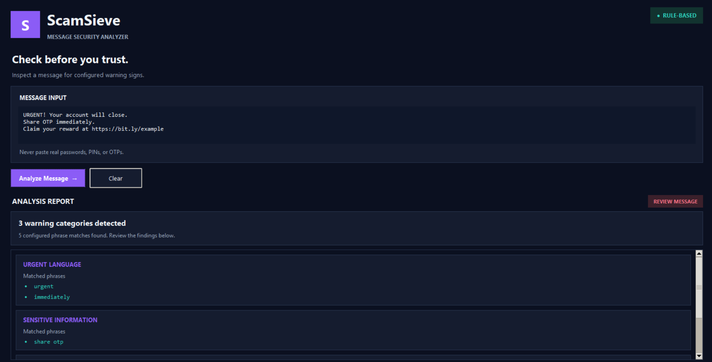

# ScamSieve 🔎

**A Python-based suspicious-message analyzer with a desktop GUI and command-line interface.**

ScamSieve identifies predefined warning signs in text messages using rule-based keyword matching. It highlights phrases associated with urgency, financial requests, sensitive information, and suspicious links, helping users recognize patterns that deserve closer inspection.

Built as a learning project, ScamSieve explores Python programming, regular expressions, automated testing, GUI development, and software version control.

> **Disclaimer:** ScamSieve is an educational warning tool, not a definitive scam detector. A warning does not prove fraud, and a message with no warnings is not necessarily safe.

## Table of Contents

- [Features](#features)
- [Application Preview](#application-preview)
- [How It Works](#how-it-works)
- [Technology Stack](#technology-stack)
- [Getting Started](#getting-started)
- [Usage](#usage)
- [Running Tests](#running-tests)
- [Project Structure](#project-structure)
- [Current Detection Rules](#current-detection-rules)
- [Limitations and Security Notes](#limitations-and-security-notes)
- [Learning Outcomes](#learning-outcomes)
- [Roadmap](#roadmap)
- [Contributing](#contributing)
- [Author](#author)

## Features

- **Urgency detection:** Identifies configured phrases such as `urgent`, `immediately`, and `act now`.
- **Financial-request detection:** Flags phrases such as `send money`, `payment required`, and `pay now`.
- **Sensitive-information warnings:** Detects configured requests involving OTPs, passwords, and PINs.
- **Suspicious-link warnings:** Identifies configured URL patterns, including HTTP/HTTPS links and URL-shortening domains.
- **Explainable results:** Displays the warning categories and matched phrases that triggered them.
- **Desktop interface:** Provides a graphical input area, analysis results, a status indicator, and a Clear button.
- **Command-line interface:** Supports message analysis directly in the terminal.
- **Input validation:** Rejects empty messages and non-string inputs in the analysis function.
- **Automated testing:** Uses Python's built-in `unittest` framework.

## Application Preview



ScamSieve provides a desktop interface for entering a message and reviewing the warning signs detected by its rules.

## How It Works

ScamSieve follows a simple analysis pipeline:

1. **Input:** The user provides a text message.
2. **Validation:** The analysis function checks that the input is a non-empty string.
3. **Normalization:** The message is converted to lowercase for case-insensitive matching.
4. **Rule matching:** The analyzer searches for predefined warning phrases and patterns.
5. **Categorization:** Matches are grouped into warning categories.
6. **Results:** The command-line interface or desktop GUI presents the findings.

### Example

**Input message**

```text
URGENT! Send money immediately to avoid account suspension.
```

**Expected warning categories**

- Urgent language
- Financial requests

The actual results depend on the configured rules and the phrases present in the message.

ScamSieve uses regular expressions with word boundaries to reduce accidental matches inside larger words.

## Technology Stack

| Technology | Purpose |
|---|---|
| Python | Core programming language |
| Regular expressions (`re`) | Text and keyword matching |
| Tkinter / `ttk` | Desktop graphical interface |
| `unittest` | Automated testing |
| Git and GitHub | Version control and project hosting |

The current application uses Python's standard library and does not require third-party Python packages.

## Getting Started

### Prerequisites

- Python 3.10 or later recommended
- Tkinter available in your Python installation for the desktop GUI
- Git, if you want to clone the repository

Verify your Python installation:

```bash
python --version
```

On some macOS and Linux installations, use `python3` instead of `python`.

### 1. Clone the repository

```bash
git clone https://github.com/MananCodes-Dev/ScamSieve.git
cd ScamSieve
```

### 2. Create a virtual environment

A virtual environment keeps the project's Python environment separate from other projects.

**Windows PowerShell**

```powershell
python -m venv .venv
.venv\Scripts\Activate.ps1
```

**macOS / Linux**

```bash
python3 -m venv .venv
source .venv/bin/activate
```

If PowerShell prevents environment activation, you can still run the project using the Python executable inside `.venv`.

### 3. Run the command-line interface

```bash
python src/scamsieve.py
```

Enter a message when prompted and review the warning categories and matched phrases.

### 4. Launch the desktop application

```bash
python -m src.gui
```

Enter a message in the input area and select **Analyze Message**. Use **Clear** to reset the input and results.

## Running Tests

Run the automated test suite from the repository root:

```bash
python -m unittest discover -s tests -v
```

The existing test suite contains 10 tests covering:

- Urgent-language detection
- Sensitive-information detection
- Multiple warning categories
- Matched-phrase reporting
- Normal messages without configured warning signs
- Empty and invalid input
- URL and shortened-link patterns
- Keyword boundary behavior
- HTTP and HTTPS link detection

Tests help verify expected behavior for the cases covered. They do not establish that ScamSieve can detect every scam.

## Project Structure

```text
ScamSieve/
├── src/
│   ├── scamsieve.py
│   └── gui.py
├── tests/
│   └── test_scamsieve.py
├── screenshots/
│   └── scamsieve-gui.png
├── README.md
└── .gitignore
```

**Key files**

- `src/scamsieve.py` — contains the warning rules, analysis function, and command-line interface.
- `src/gui.py` — implements the Tkinter desktop application.
- `tests/test_scamsieve.py` — contains automated tests for the analysis function.
- `screenshots/scamsieve-gui.png` — shows the desktop application's interface.
- `README.md` — documents the project, setup, usage, and limitations.

## Current Detection Rules

The analysis engine groups configured phrases into four categories.

| Category | Example configured phrases |
|---|---|
| Urgent language | `urgent`, `immediately`, `act now` |
| Financial requests | `send money`, `payment required`, `pay now` |
| Sensitive information | `share otp`, `share your password`, `share your pin` |
| Suspicious links | `http://`, `https://`, `bit.ly`, `tinyurl.com` |

The rules are predefined in the source code. They are not learned from a dataset, and the current implementation does not use an AI or machine-learning model.

## Limitations and Security Notes

ScamSieve is an early-stage, rule-based project. Its results should be treated as warning signals rather than security verdicts.

- **Limited vocabulary:** It may miss suspicious messages that use unfamiliar wording or patterns.
- **False positives:** Legitimate messages can contain phrases associated with scams.
- **Limited context:** It does not understand the sender's identity, intent, or the full context of a conversation.
- **No URL reputation checks:** It does not establish whether a website is malicious or trustworthy.
- **No threat-intelligence integration:** It does not query external security databases or provide real-time threat analysis.
- **No machine learning:** It relies on manually configured rules rather than a trained classification model.

An HTTPS connection does not guarantee that a website is trustworthy.

**Safety advice:** Never disclose an OTP, password, PIN, or other sensitive information simply because a message looks legitimate. Verify suspicious requests through an official contact channel obtained independently of the message.

## Learning Outcomes

This project provided practical experience with:

- Python functions, dictionaries, loops, and exception handling
- String normalization and regular expressions
- Input validation and error handling
- Writing and running automated unit tests
- Separating analysis logic from the graphical interface
- Building a desktop application with Tkinter
- Git commits, branches, merges, and GitHub workflows
- Writing technical documentation and identifying software limitations

## Roadmap

Potential future improvements, subject to implementation and testing:

- [ ] Expand test coverage for false positives and false negatives.
- [ ] Improve URL extraction and detection.
- [ ] Allow warning rules to be configured without editing the analysis logic.
- [ ] Add a documented test dataset and measure detection performance.
- [ ] Improve GUI accessibility and usability.
- [ ] Explore URL reputation services with appropriate privacy safeguards.
- [ ] Investigate machine-learning-based classification and compare its performance against the rule-based baseline.

These are planned improvements, not features currently implemented.

## Contributing

Suggestions, bug reports, and improvements are welcome.

1. Fork the repository.
2. Create a branch for your change.
3. Make your changes and add tests where appropriate.
4. Run the existing test suite.
5. Open a pull request describing the change and its purpose.

Please avoid including real private messages, personal information, OTPs, passwords, or other sensitive data in test cases.

## Author

**Manan Kumar**

-